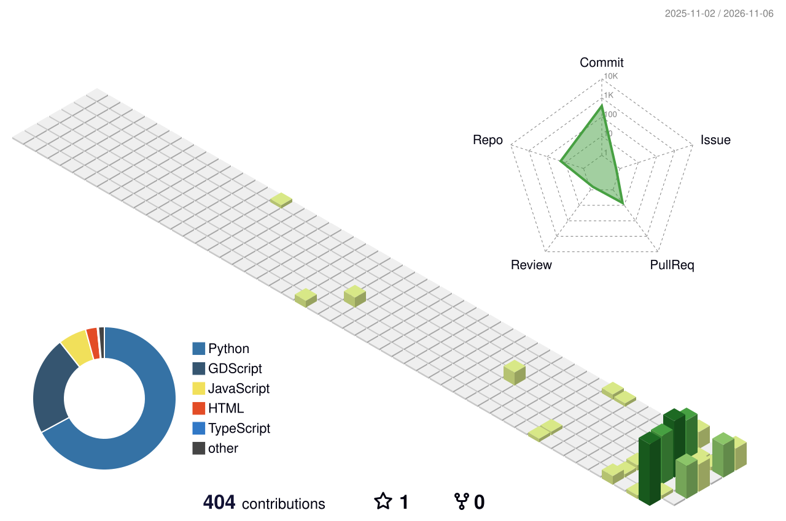

<!-- =============================================================== -->
<!-- ABHAY SHRAVAN | MULTI-DISCIPLINARY COMPUTER ENGINEER             -->
<!-- Advanced engineering-dashboard profile README                  -->
<!-- =============================================================== -->

  

  

  

    
    
  

  

---

## `01 / PROFILE OVERVIEW`

<table>
  <tr>
    <td width="62%" valign="top">
      <h3>Hi, I'm Abhay 👋</h3>
      
I'm a <strong>Third-Year B.Tech Computer Engineering student</strong> at <strong>SNJB's Late Sau. K. B. Jain College of Engineering, Chandwad</strong>.

      
I enjoy exploring how different parts of computing connect. My interests span software development, AI-assisted engineering, computer networks, system architecture and interactive technical learning experiences.

      
I learn best by understanding a concept, breaking it into parts, experimenting with it and turning it into a working project.

    </td>
    <td width="38%" valign="top">
      <h3>Engineering profile</h3>
      <table>
        <tr><td><strong>Role</strong></td><td>Computer Engineering Student</td></tr>
        <tr><td><strong>Approach</strong></td><td>Learn → Design → Build → Improve</td></tr>
        <tr><td><strong>Environment</strong></td><td>VS Code</td></tr>
        <tr><td><strong>Exploring</strong></td><td>Software, AI, Networks, Systems</td></tr>
        <tr><td><strong>GitHub</strong></td><td><a href="https://github.com/abhayshravan357-sudo">@abhayshravan357-sudo</a></td></tr>
      </table>
    </td>
  </tr>
</table>

> **Engineering mindset:** I don't want to stay inside one technology box. I want to understand the layers, see how they interact, and build useful things across them.

## `02 / ENGINEERING DOMAINS`

<table>
  <tr>
    <td width="50%" valign="top">
      <h3>01 — Software & Web</h3>
      Building programming fundamentals and experimenting with web-based applications and interfaces.
      
Exploring: Python · JavaScript · HTML · CSS

    </td>
    <td width="50%" valign="top">
      <h3>02 — AI-assisted Engineering</h3>
      Exploring how AI tools and specialized agents can support planning, implementation, coordination and review in complex projects.
      
Exploring: AI workflows · Multi-agent collaboration

    </td>
  </tr>
  <tr>
    <td width="50%" valign="top">
      <h3>03 — Networks & Infrastructure</h3>
      Learning how modern networks are designed, controlled, virtualized and orchestrated.
      
Exploring: SDN · NFV · MANO · VNF

    </td>
    <td width="50%" valign="top">
      <h3>04 — Systems & Architecture</h3>
      Interested in connecting components into understandable systems, simulations and end-to-end workflows.
      
Exploring: System design · Architecture · Simulations

    </td>
  </tr>
</table>

## `03 / SELECTED BUILDS`

### <a href="https://github.com/abhayshravan357-sudo/sdn-nfv-quest">01. SDN + NFV Quest</a>

**Interactive networking learning game** · [Open the live experience ↗](https://sdn-nfv-quest.netlify.app/)

A game-style learning experience designed to make Software-Defined Networking and Network Function Virtualization easier to understand through guided levels and interactive challenges.

  
  

### 02. SDN–NFV Interactive Case Study

**Interactive technical case study** · [Open the case study ↗](https://abhayshravan357-sudo.github.io/sdn-nfv-case-study/)

An interactive walkthrough of the relationship between **SDN → NFV → MANO → VNF**, bringing the architecture together through a knowledge graph, structured notes and a guided learning flow.

### 03. Project Atlas — AI Engineering Ecosystem

**In development** · [View my repositories](https://github.com/abhayshravan357-sudo?tab=repositories)

An exploration of a coordinated, multi-agent engineering environment. The design includes a manager agent, specialized engineering agents, isolated branches and worktrees, shared standards, and review practices — with the goal of making complex software work more organized and maintainable.

---

## `04 / TOOLS IN MY WORKBENCH`

  
<b>Languages & Web</b>

  
  
<b>Development Tools</b>

  

These are tools and technologies I am learning, using or exploring. The list is not intended to imply equal proficiency in every item.

## `05 / GITHUB TELEMETRY`

  
  
   
  

  
<b>Open the animated contribution snake</b>

   
  

    <picture>
      <source media="(prefers-color-scheme: dark)" srcset="https://raw.githubusercontent.com/abhayshravan357-sudo/abhayshravan357-sudo/output/github-contribution-grid-snake-dark.svg" />
      <source media="(prefers-color-scheme: light)" srcset="https://raw.githubusercontent.com/abhayshravan357-sudo/abhayshravan357-sudo/output/github-contribution-grid-snake.svg" />
      
    </picture>
  

  
<b>Open the 3D contribution profile</b>

   
  

    
  

---

## `06 / CONNECT`

  
  
More links will be added as my project portfolio grows.

  <h3>Thanks for exploring my corner of GitHub.</h3>
  <i>Stay curious. Build with purpose. Keep improving.</i>
    
  

